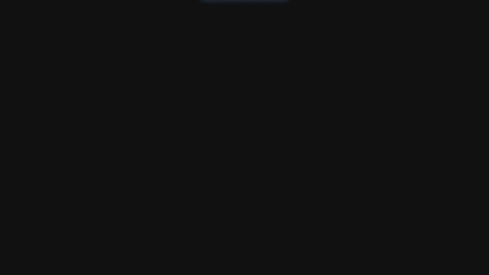
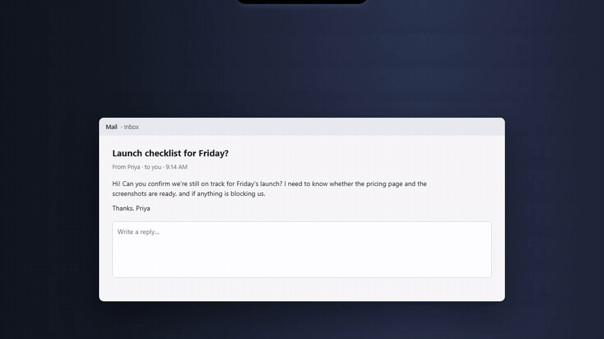

<div align="center">

# Agent Desk

**A voice-first AI assistant for Windows that stays out of the way until you need it.**

Hold <kbd>Ctrl</kbd> + <kbd>Alt</kbd>, say what you need, let go.
The answer appears in a small notch at the edge of your screen.

[](https://github.com/Kedhareswer/Agent-desk/actions/workflows/ci.yml)
[](https://github.com/Kedhareswer/Agent-desk/releases/latest)
[](#requirements)
[](LICENSE)

[Download](https://github.com/Kedhareswer/Agent-desk/releases/latest) ·
[Install](#install) ·
[How to use it](#how-to-use-it) ·
[Privacy](#privacy-and-security) ·
[Contributing](CONTRIBUTING.md)

<br>



</div>

## Why Agent Desk

- **Uses the subscription you already have.** Agent Desk answers through
  the [Claude Code](https://claude.com/claude-code) or
  [Codex](https://github.com/openai/codex) command-line tool you are
  signed in to. There is no API key, no account and no extra bill.
- **Sees what you see.** The window you were in and a screenshot of your
  screen go with your question, so "draft a reply" or "what does this
  error mean" is enough.
- **Fast.** First words usually arrive in 1 to 3 seconds. The AI process
  starts warming up the moment you press the keys.
- **Private.** Your voice is transcribed on your own computer and never
  uploaded. The notch is hidden from screen sharing by default.
- **Light.** A native app (Tauri and Rust, not Electron). When idle it is
  one small tray process.

## Features

| | |
| --- | --- |
| 🎙️ **Hold to talk** | Hold <kbd>Ctrl</kbd> + <kbd>Alt</kbd>, speak, release. No Enter key. |
| ⌨️ **Tap to type** | A quick tap opens the same notch with a text box. |
| 🤝 **Work with me (live mode)** | <kbd>Ctrl</kbd> + <kbd>Alt</kbd> + <kbd>L</kbd> follows a call or a session and speaks up only when it can help, for example when someone asks a question. |
| 🖱️ **Does things for you** | "Open Chrome and go to GitHub", "attach the report from Documents and send it to my team in Teams". It sees buttons and links by name, moves the pointer visibly, clicks, types, reads Word and PDF files. Every step shows in the notch; anything that sends, deletes, buys or runs a command waits for your OK. |
| ⏰ **Schedules** | "Every weekday at 9, open my calendar and summarise today." "Remind me at 5 to send the report." Pause, edit or delete them in Settings. |
| 📋 **Paste back** | <kbd>Ctrl</kbd> + <kbd>Enter</kbd> puts the answer into the app you came from. |
| 🧩 **One notch** | It shows only its state (Listening, Thinking, Answering) and grows into the answer when there is something to read. |
| 📐 **Any edge, any screen** | Drag it to the top, bottom, left or right of any monitor. Transparency is adjustable. |
| 🙈 **Hidden from screen shares** | The notch and its glow do not appear in screenshots, recordings or calls (you can turn this off). |
| 🔄 **Updates itself** | Installer copies check for new versions in the background and offer "Restart to update" in the tray. |

## Requirements

- Windows 10 (version 2004 or later) or Windows 11.
- One of these, installed and signed in:
  - [Claude Code](https://claude.com/claude-code) with a Claude plan. Run
    `claude` once in a terminal to sign in.
  - The Codex CLI (`npm install -g @openai/codex`) with a ChatGPT plan.
    Run `codex` once to sign in.
- A microphone.

## Install

| Method | Command or download | Updates |
| --- | --- | --- |
| **Installer** (recommended) | [`Agent-Desk_<version>_x64-setup.exe`](https://github.com/Kedhareswer/Agent-desk/releases/latest) | In the app |
| **Scoop** | `scoop bucket add agent-desk https://github.com/Kedhareswer/Agent-desk`<br>`scoop install agent-desk` | `scoop update agent-desk` |
| **Portable** | [`Agent-Desk_<version>_x64-portable.zip`](https://github.com/Kedhareswer/Agent-desk/releases/latest), unzip, run `agent-desk.exe` | Download again |
| **winget** *(coming soon)* | `winget install Kedhareswer.AgentDesk` | `winget upgrade` |
| **Chocolatey** *(coming soon)* | `choco install agent-desk` | `choco upgrade` |

The installer is per user, so it needs no administrator rights. Every
release lists SHA-256 checksums in `SHA256SUMS.txt`. The app is not code
signed yet, so Windows SmartScreen asks you to confirm the first time.

## How to use it

<div align="center">

</div>

1. **Start Agent Desk.** It lives in the tray, next to the clock.
2. **Hold <kbd>Ctrl</kbd> + <kbd>Alt</kbd> and speak.** Let go when you are
   done. The first time, it downloads the speech model once (148 MB) and
   shows the progress.
3. **Read the answer** in the notch. Use **Insert** (<kbd>Ctrl</kbd> +
   <kbd>Enter</kbd>) to paste it where you were, **Copy**, or **New** for a
   fresh conversation.
4. **Ask a follow-up** by holding the keys again. The conversation
   continues until you start a new one.
5. **Press <kbd>Esc</kbd>** to stop an answer or hide the notch.

### Keyboard shortcuts

| Keys | Action |
| --- | --- |
| <kbd>Ctrl</kbd> + <kbd>Alt</kbd> (hold) | Talk; release to send |
| <kbd>Ctrl</kbd> + <kbd>Alt</kbd> (tap) | Open the notch to type, or hide it |
| <kbd>Ctrl</kbd> + <kbd>Alt</kbd> + <kbd>L</kbd> | Turn live mode on or off |
| <kbd>Ctrl</kbd> + <kbd>Alt</kbd> + <kbd>Enter</kbd> | Paste the answer into the app in front |
| <kbd>Enter</kbd> | Send what you typed (empty asks about your screen) |
| <kbd>Shift</kbd> + <kbd>Enter</kbd> | New line |
| <kbd>Ctrl</kbd> + <kbd>Shift</kbd> + <kbd>C</kbd> | Copy the answer |
| <kbd>Ctrl</kbd> + <kbd>N</kbd> | New conversation |
| <kbd>Ctrl</kbd> + <kbd>,</kbd> | Settings |
| <kbd>Ctrl</kbd> + <kbd>H</kbd> | Earlier answers |
| <kbd>Esc</kbd> | Stop the answer, then hide |

Prefer a different key? Set your own shortcut in Settings (default
<kbd>Ctrl</kbd> + <kbd>Alt</kbd> + <kbd>Space</kbd>). It works the same
way: hold to talk, tap to type.

### Settings

Open Settings from the tray or with <kbd>Ctrl</kbd> + <kbd>,</kbd>. You can
choose Claude or Codex and the model (Claude Haiku is the default because it
is the fastest), the speech model (75 MB, 148 MB or 488 MB, larger is more
accurate), the screen edge, transparency, whether a screenshot is sent,
start with Windows, and automatic updates.

### First launch

The first time it starts, the notch opens on a setup screen. It checks
that Claude Code (or the Codex CLI) is installed and signed in and shows
the account and plan, copies the sign-in command if you need it, lets you
pin one account folder so Agent Desk always uses that sign-in, picks the
model from the CLI's own list, shows which speech models are downloaded
(and downloads one with a progress bar), and explains how to use it. Open
it again any time from the tray: **Setup and guide**.

### Actions

Agent Desk can do things on your computer, not just answer. Ask for it the
way you would ask a person:

- "Open Chrome and go to GitHub." / "Open my Gmail in Chrome" (it asks once
  which profile, then remembers).
- "Open Spotify." / "Switch to the Word document." / "Open my Downloads folder."
- "Read the update in Documents\Reports and tell me what is blocked."
- "Write a summary of that document in my Teams chat with Sam and attach it."
- "Press Ctrl+T." / "Run *Build site*" (a command you saved in Settings).

It works like a person at the keyboard: it reads the buttons, links and
text boxes of the app in front by name (Windows' accessibility interface,
the one screen readers use, which also sees inside web pages), moves the
mouse pointer so you can see where it is going, clicks, types, scrolls,
uses the clipboard, opens files and folders, and reads text, Word and PDF
documents. It works in your own signed-in browser and profile. It has no
shell: only this fixed list, plus commands you saved yourself.

Each step appears in the notch before it runs. Steps that could send,
delete, buy or run something wait for you: **Allow** (or <kbd>Enter</kbd>),
**Always allow** (stops asking for that kind of step, or for that one
button; undo it in Settings), or **Don't** (or <kbd>Esc</kbd>). Clicking a
button such as Send, Post, Delete, Buy, Pay or Submit, pressing Enter,
Delete or Ctrl+W, opening a program, saved commands and new schedules
always ask. Reading the screen, opening pages, apps and documents, clicking
ordinary buttons and links, and typing into a box (new lines are typed
without sending) just run. Folders that hold keys and app data (`.ssh`,
`AppData`, `.env` files) are never read.

Attaching a file in Teams or OneDrive-backed apps uploads it to your cloud
storage as soon as it is attached, before you press Send.

The AI is told never to act on instructions it finds on your screen or in
a web page, and the confirmations above are there in case it does. Actions
are never available in live mode, where it hears other people. You can turn
actions off in Settings.

### Schedules

Say "every weekday at 9, open my calendar and summarise today" or "remind
me at 5 to send the report", or add one in **Settings → Schedules**. At that
time the notch opens and Agent Desk does the task as if you had just asked.
Schedules can repeat on chosen days or run once, and you can pause, edit,
run now or delete them.

They are stored in `schedules.json` next to your settings and run inside
the tray app, so they only run while Agent Desk is running (turn on **Start
with Windows** for that). If the computer was asleep, a repeating task still
runs if it wakes within 30 minutes; a one-time reminder always runs, late.

### Live mode

Live mode listens to your microphone ("Me") and to your computer's audio
("Them", the other people in a call). It looks at your screen at most every
15 seconds and stays silent unless it has something useful to add. It uses
more of your plan's allowance than asking by hand, because everything said
is a request.

> **Recording other people may need their consent.** Depending on where you
> and they are, the law may require you to tell them. Live mode never starts
> by itself.

## Privacy and security

- **Your voice stays on your computer.** Speech is transcribed locally with
  [whisper.cpp](https://github.com/ggml-org/whisper.cpp). Only the text, the
  window title and (if enabled) a screenshot are sent, and only through
  your own Claude or Codex CLI.
- **The AI can act only through Agent Desk.** Claude runs with its own
  tools, your MCP servers and its history turned off, in an empty folder.
  Its only tools are Agent Desk's actions, served on `127.0.0.1` with a
  random per-run key; requests from web pages are refused. Codex runs in a
  read-only sandbox with Agent Desk's actions added (your Codex apps,
  plugins and MCP servers are switched off for these runs). Risky steps
  wait for your OK in the notch.
- **Earlier answers stay on this computer.** The list behind the clock
  button is kept in Agent Desk's own window storage (the last 40) and is
  never sent anywhere. "Clear" removes it.
- **The keyboard hook only watches for the gesture.** Windows cannot
  register a hotkey made only of <kbd>Ctrl</kbd> + <kbd>Alt</kbd>, so Agent
  Desk uses a low-level keyboard hook. It never records, logs or changes
  your keystrokes, and it is installed only while that gesture is selected.
- **Hidden from screen shares, not disguised.** The notch uses Windows'
  own `WDA_EXCLUDEFROMCAPTURE` setting so it stays out of calls and
  recordings. Agent Desk always shows under its own name in the tray and
  Task Manager.
- **Model output is untrusted.** Answers are rendered as escaped Markdown;
  they can never run code in the notch.
- **Signed updates.** The in-app updater only installs versions signed with
  the project's release key.

Found a security problem? Please report it privately (see
[SECURITY.md](SECURITY.md)).

## How it works

```
 Ctrl + Alt ──► keyboard hook ──► microphone ──► whisper.cpp (on device)
                                                     │ text
 screenshot + window title ─────────────────────────►│
                                                     ▼
                           claude -p / codex exec (your subscription)
                                                     │ streamed answer
                                                     ▼
                                       the notch (Tauri web view)
```

| Part | File |
| --- | --- |
| Tray, windows, commands, push-to-talk and live mode | [`src-tauri/src/main.rs`](src-tauri/src/main.rs) |
| Claude and Codex CLI bridge | [`src-tauri/src/backend.rs`](src-tauri/src/backend.rs) |
| The allowed actions and their rules | [`src-tauri/src/actions.rs`](src-tauri/src/actions.rs) |
| Seeing the screen, mouse, Start-menu apps, PDF pages | [`src-tauri/src/uia.rs`](src-tauri/src/uia.rs) |
| Folders and documents, off-limits paths | [`src-tauri/src/files.rs`](src-tauri/src/files.rs) |
| Setup screen facts (sign-in, models, speech models) | [`src-tauri/src/setup.rs`](src-tauri/src/setup.rs) |
| Local MCP server the CLIs call actions through | [`src-tauri/src/mcp.rs`](src-tauri/src/mcp.rs) |
| Carrying out actions, confirmations, running schedules | [`src-tauri/src/tasks.rs`](src-tauri/src/tasks.rs) |
| Schedule times and storage | [`src-tauri/src/schedule.rs`](src-tauri/src/schedule.rs) |
| Hold, tap and shortcut detection | [`src-tauri/src/hotkey.rs`](src-tauri/src/hotkey.rs) |
| Microphone and system audio | [`src-tauri/src/audio.rs`](src-tauri/src/audio.rs) |
| Speech to text | [`src-tauri/src/stt.rs`](src-tauri/src/stt.rs) |
| Updates | [`src-tauri/src/update.rs`](src-tauri/src/update.rs) |
| Docking to a screen edge | [`src-tauri/src/dock.rs`](src-tauri/src/dock.rs) |
| Screenshot, windows, paste, typing, opening apps | [`src-tauri/src/platform.rs`](src-tauri/src/platform.rs) |
| The notch interface | [`ui/`](ui) |

[CLAUDE.md](CLAUDE.md) describes the architecture and design rules in
detail.

## Troubleshooting

| Problem | What to do |
| --- | --- |
| "The `claude` command was not found" | Install Claude Code and run `claude` once to sign in, or set its path in Settings. |
| It says "Downloading speech model" | This happens once, the first time you talk. Wait for 100%. |
| Holding <kbd>Ctrl</kbd> + <kbd>Alt</kbd> does nothing | Check that Agent Desk is in the tray. Another app may use the same keys; set your own shortcut in Settings. |
| "There is no app called … in the Start menu" | Use the name shown in the Start menu, or ask it to open the website instead. |
| A schedule did not run | Agent Desk must be running at that time. Check **Start with Windows**, and that the schedule is not paused. |
| "I didn't hear anything" | Check the microphone in Windows Settings → Privacy → Microphone, and hold the keys while you speak. |
| SmartScreen warns about the installer | Choose **More info → Run anyway**. The app is not code signed yet. |

## Development

You need Rust (stable), Node 22, CMake and LLVM/Clang (whisper.cpp is
built from source).

```bash
npm ci
```

```bash
npx playwright install chromium
```

```bash
npm run dev
```

```bash
npm test
```

`npm test` runs the Rust unit tests and the Playwright UI test, and
`npm run lint` checks formatting, Clippy and versions. The README
recordings are made from the real interface with
`node scripts/record-demo.mjs` (needs ffmpeg). See
[CONTRIBUTING.md](CONTRIBUTING.md) for pull requests and how releases and
package managers are published.

## License

[MIT](LICENSE) © Agent Desk contributors
